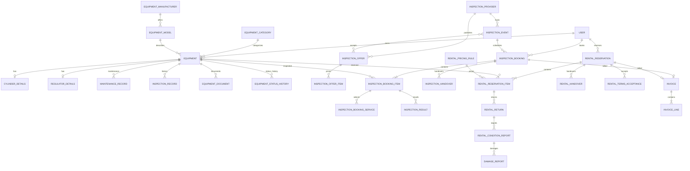

# Zielarchitektur und ER-Diagramm

## Architekturregeln

- `Domain`: fachliche Zustände, Invarianten und Value Objects; keine HTTP-/Doctrine-Abhängigkeit, wo sinnvoll.
- `Application`: Use Cases/Services, Transaktionsgrenzen, Berechtigungsorchestrierung und Outbox-/Message-Aufträge.
- `Infrastructure`: Doctrine-Repositories, Dateispeicher, PDF/XLSX-Adapter, Mail-/Messenger-Handler.
- `UI`: Controller, DTOs, Symfony Forms, Voters, Twig/Stimulus. Controller orchestrieren nur.
- Preisbeträge: integer in kleinsten Währungseinheiten oder exakte Dezimalstrings/DB `NUMERIC`; niemals PHP `float`.
- Zeitfenster: halb offen `[start, end)`. Zwei Fenster überlappen nur, wenn `a.start < b.end && b.start < a.end`.
- Gerätezustand, Aufenthaltsort, Reservierungsstatus, Prüfstatus und Zahlungsstatus sind separate Zustandsdimensionen.
- Dokumente werden privat gespeichert, mit MIME-/Größenprüfung, Hash, Upload-Metadaten und Zugriff über Controller/Voter.
- Jede asynchrone Benachrichtigung erhält einen stabilen Idempotenzschlüssel. Für verlässliche Zustellung wird eine Outbox-Strategie geprüft.
- PostgreSQL Constraints sind die letzte Schutzlinie; UI-Verfügbarkeitsprüfung ist nicht autoritativ.

## ERD (fachlicher Entwurf)

Das Diagramm ist ein fachlicher Entwurf, keine bereits erzeugte Doctrine-Migration. Die konkreten Kardinalitäten bei Rechnungen, Angebot-/Termin-Zuordnung, Reglerkomponenten und Paket-/Flaschenbeziehungen werden bei der Entity-Implementierung durch die bestätigten Geschäftsregeln präzisiert.

## Getrennte Statusmodelle

- `EquipmentCondition`: `serviceable`, `restricted`, `damaged`, `lost`, `retired`.
- `EquipmentLocation`: Lagerort, Mitglied, Prüfstelle, Werkstatt, unbekannt (als eigene Bewegungs-/Historienereignisse modellieren).
- `RentalReservationStatus`: `requested`, `confirmed`, `cancelled`, `completed`.
- `RentalItemStatus`: `reserved`, `issued`, `partially_returned`, `returned`, `overdue`.
- `InspectionBookingStatus`: `submitted`, `confirmed`, `received`, `sent_to_provider`, `partially_completed`, `completed`, `cancelled`.
- `InspectionResultStatus`: `pending`, `passed`, `failed`, `rework_required`.
- `PaymentStatus`: `not_due`, `open`, `partially_paid`, `paid`, `void`.
- `MaintenanceStatus`: als Termin-/Zeitraumdaten und Sperrereignis, nicht als Reservierungsstatus.

Die Werte sind ein Vorschlag für die Modellierung und müssen vor endgültiger Festlegung mit dem Verein abgestimmt werden. Die getrennten Dimensionen verhindern, dass eine bestandene Teilprüfung oder Rückgabe den Status anderer Positionen überschreibt.

## Bestätigte fachliche Entscheidungen (15.10.2026)

- **Umsatzsteuer:** Der Verein möchte Rechnungen ohne Umsatzsteuerausweis erstellen. Preise werden als ganzzahlige Minor Units (z. B. Cent) gespeichert; es gibt keine Float-Arithmetik. Die Anwendung weist keine Umsatzsteuerposition aus. Dies ist eine Produktanforderung und keine rechtliche Feststellung zur steuerlichen Einordnung des Vereins. Vor produktiver Rechnungsstellung muss die steuerliche Behandlung durch den Verein bzw. dessen Steuerberatung bestätigt werden.
- **Prüftermin-Kapazität:** Kapazität ist pro Prüfstelle und konkretem Prüftermin konfigurierbar. Es gibt keinen globalen Standardwert, aus dem die Buchungslogik stillschweigend ableiten darf. Die spätere Buchung muss den konkreten Termin innerhalb einer Datenbanktransaktion sperren und dessen Kapazität neu prüfen.
- **Prüffrist:** Nach einer erfolgreich bestandenen Prüfung beträgt das Intervall 30 Kalendermonate (2 Jahre und 6 Monate). Der Tag wird im Zielmonat beibehalten und bei einem kürzeren Zielmonat auf dessen letzten gültigen Tag begrenzt. Fehlgeschlagene Prüfungen erzeugen keine neue Prüffrist. Die Regel ist zentral im `InspectionIntervalPolicy` gekapselt.

### Kapazitätsmodell für Prüftermine

`InspectionEvent` referenziert genau eine `InspectionProvider` und besitzt eine explizite Kapazität (z. B. `capacityCylinders` für die Zahl der Flaschen). Welche Kapazitätseinheit fachlich verbindlich ist, ist noch zu entscheiden: Die aktuelle Modellierung geht von Flaschenplätzen aus, weil eine Buchung mehrere Flaschen umfassen kann. Eine optionale zweite Grenze für Buchungen kann später ergänzt werden, falls die Prüfstelle beides vorgibt. Die Buchungsprüfung zählt nur kapazitätswirksame Buchungspositionen und muss Stornierungen konsistent ausschließen.

## Deployment-Kontext (dicoma1510)

Die Zielumgebung ist eine bereits installierte Symfony-Anwendung auf dem Server unter `https://fakt.diversworld.eu`. Es wird keine lokale Docker-Umgebung vorausgesetzt. Die vorhandene MySQL-/MariaDB-Verbindung bleibt maßgeblich; `DATABASE_URL` darf nicht durch eine Beispielkonfiguration überschrieben werden. PostgreSQL und Docker Compose aus früheren Entwürfen sind für dieses Projekt verworfen.
